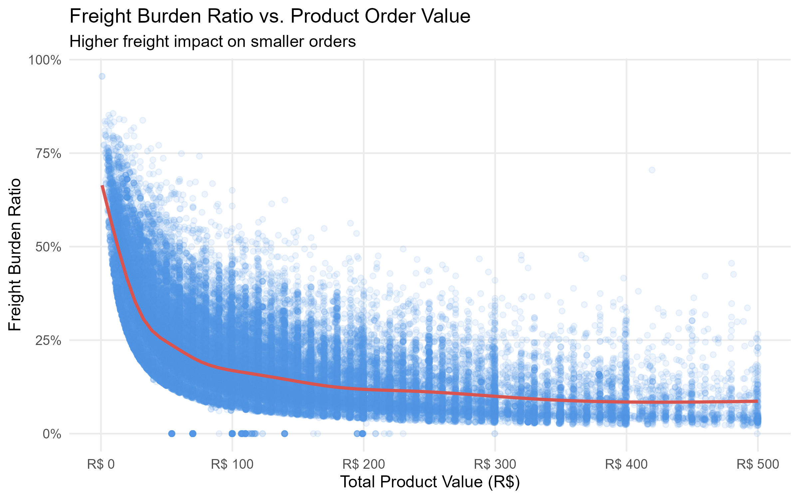
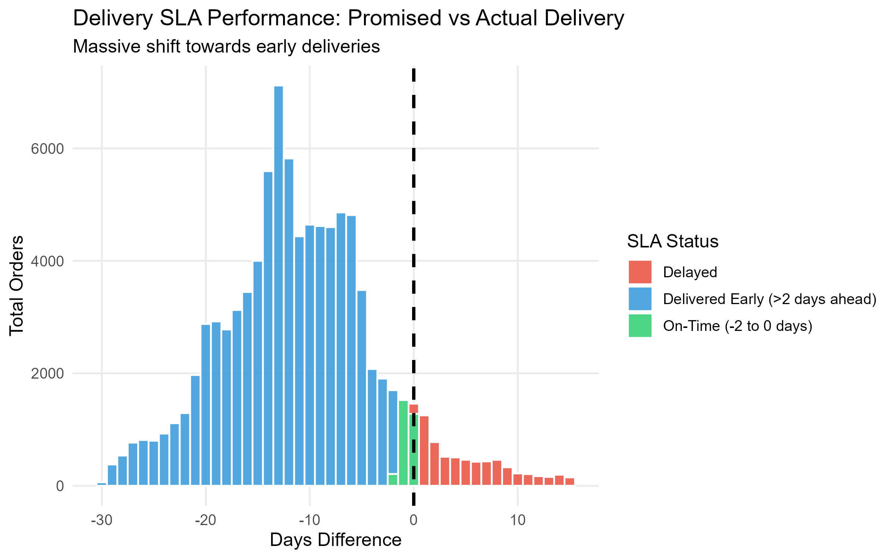

# Brazilian E-Commerce Analysis: Order Economics, Payment Behaviour & Delivery SLA Performance

---

**Role:** Data Analyst  
**Tools & Techniques:** R (v4.5+, `tidyverse`, `dplyr`, `ggplot2`, `readr`, `scales`), EDA, Logistics SLA Analytics  
**Data Processing:** Metric transformations (AOV, Freight Burden Ratio, SLA variance logic), continuous datetime handling, and custom Flat UI visual styling  
**Scope:** Analysis of 100k+ Olist order records (2016-2018)

---

## 📌 Executive Summary
This repository delivers a data-driven commercial evaluation of Olist's e-commerce marketplace operations using **R**. By bridging mathematical rigor with strategic commercial logic, this study isolates key operational inefficiencies impacting conversion rates and profit margins. 

The analysis focuses on four core operational pillars:
1. **Payment Mix Optimization & Cash-Flow Velocity**
2. **High-Ticket Installment Financing & Margin Protection**
3. **Micro-Transaction Freight Burden & PUDO Locker Solutions**
4. **Dynamic Delivery SLA Calibration & Competitive Positioning**

---

## 📈 Commercial Insights & Strategic Recommendations

### 1. Payment Mix Optimization & Retention Strategy
* **Strategic Finding:** Credit Cards represent the primary locomotive of growth, generating the vast majority of financial volume (Revenue Share). Conversely, traditional cash-based methods like **Boleto** introduce operational latency, locking up merchant inventory for days before payment clearance and freezing cash flow.
* **Actionable Solution:** **Credit Card Loyalty & Instant Rewards Program**  
  Implement targeted cashback or loyalty points at checkout for credit card transactions. Introducing immediate incentives seamlessly migrates shoppers away from delayed-settlement methods towards instant digital checkout, accelerating working capital velocity.

---

### 2. Premium Installment Marketing & Margin Protection
* **Strategic Finding:** A prominent volume spike at **8 to 10 installments** reveals strong consumer demand for financing. However, offering multi-month interest-free financing on low-value items eats directly into profit margins due to high interchange fees.
* **Actionable Solution:** **Tiered Installment Display & Framing Strategy**  
  Restrict multi-month financing (e.g., 8–10 installments) strictly to high-ticket items (e.g., orders above R$ 200). On product pages for premium goods, reframe the UI/UX from the total price to an accessible monthly cost (*"Own it for just R$ 20/month"*), reducing upfront price friction and unlocking latent demand.

---

### 3. Hyper-Local Logistics & Micro-Transaction Rescue
* **Strategic Finding:** Low-value orders (under R$ 50) suffer from a severe Freight Burden Ratio, with shipping fees often absorbing **50% to 70% of total checkout value**. This triggers the *sunk cost fallacy* for consumers, causing heavy cart abandonment at the final step.
* **Actionable Solution:** **PUDO (Pick-Up / Drop-Off) Lockers & Partner Hubs**  
  Expand the logistical network by integrating secure PUDO Lockers and collection points in high-density urban areas. Giving budget-conscious buyers a low-cost self-collection alternative dramatically lowers the freight burden ratio without sacrificing merchant margins.



---

### 4. Dynamic SLA Calibration & Competitive Advantage
* **Strategic Finding:** Logistics evaluation shows a massive systematic shift towards early arrivals, proving that the fulfillment chain operates efficiently, but the checkout engine over-buffers delivery dates (promising 15+ days when couriers deliver in 5). Over-promising delivery timelines creates a critical conversion vulnerability against nimbler competitors.
* **Actionable Solution:** **Dynamic SLA Calibration Engine**  
  Replace static delivery estimates with a real-time courier tracking calculation engine. Safely narrowing the promised delivery window on checkout pages directly boosts top-of-funnel conversion rates and captures market share.



---

## 🧩 Methodology & Operational Tolerance Note (The Mathematician's Touch)
> *"As an analyst with a mathematical background, while the absolute reference point for an on-time delivery is mathematically zero variance, a live commercial supply chain necessitates a structured tolerance window. Therefore, a 2-day operational buffer (`-2` to `0` days) was purposefully utilized to define standard 'On-Time' delivery. This mathematical constraint ensures that baseline logistical noise is isolated from genuine extreme early arrival anomalies, safeguarding data integrity during executive review."*

---

## 🚀 Future Analysis & Actionable Next Steps

* **Checkout ETA A/B Testing:** Launch a 60-day controlled A/B test on checkout delivery promises to measure the exact conversion rate uplift achieved by displaying faster, realistic delivery dates.
* **Geographic Order Density Audit:** Conduct a spatial breakdown by state to identify high-density urban corridors for priority PUDO 

---

## How to Reproduce Analysis
1. Clone repository:
   ```bash
   git clone https://github.com/ariana-zylf/brazilian-ecommerce-case-study.git
    

